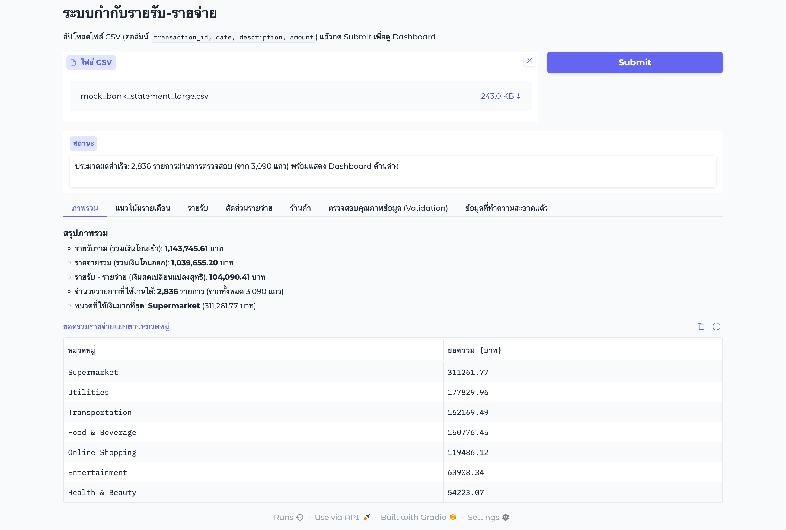

# 💰 Personal Finance Data Pipeline & Interactive Dashboard

[](https://colab.research.google.com/github/wachirapatsiri/personal-finance-pipeline-dashboard/blob/main/personal_finance_pipeline_dashboard.ipynb)


A Python data pipeline and Gradio dashboard that cleans, validates and categorizes messy bank-statement CSVs, then visualizes income and spending.

## 📌 Problem

Summarizing a raw bank export by hand is slow and error-prone. Real statements are messy: the same merchant is spelled many ways (`Grab` / `GRABB` / `grab ride`), dates come in several formats (including Thai Buddhist-era years and Thai digits), amounts carry `฿` or commas, and files contain blanks, negatives and duplicate rows.

## 🛠️ What it does

**Tech stack:** Python, pandas, TheFuzz (fuzzy matching), Matplotlib/Seaborn, Gradio

| Step | Handling |
|---|---|
| Duplicates | Drops repeated `transaction_id` (keeps the first) |
| Amounts | Parses `฿`, commas and Thai digits; handles blanks and negatives |
| Balance reconciliation | If the `balance` column is consistent (≥ 90% of rows), recovers missing amounts and fixes sign errors from balance differences |
| Dates | Parses `YYYY-MM-DD`, `DD/MM/YYYY`, `DD-MM-YYYY`, Buddhist-era years and Thai digits; rejects impossible dates (`31-02-2026`, `0000-00-00`) |
| Categorization | Fuzzy matching (`token_set_ratio`, threshold 70) against a merchant dictionary, run on unique names only |
| Cross-check | Compares the assigned income/expense flow with the file's `type` column |
| Audit trail | Every dropped or modified row is kept in a `flagged` table with its source line number, reason and action |
| Dashboard | Upload a CSV and get KPIs, monthly trend, category share, top merchants, a data-quality report and the cleaned CSV |

## 📈 Results (on included mock data)

| Dataset | Raw rows | Clean rows | Highlights |
|---|---|---|---|
| `mock_bank_statement_large.csv` | 3,090 | **2,836 (91.8%)** | 90 duplicate IDs and 164 blank rows removed; 1,889 dates standardized; 27 spellings consolidated into 17 merchants across 7 expense categories |
| `mock_bank_statement_small.csv` | 490 | **478 (97.6%)** | 6 duplicates and 6 impossible dates removed; 337 dates standardized (2 Buddhist-era); 11 missing amounts recovered and 16 negative amounts fixed using balance |

> The data is **synthetic**: it was generated with deliberately injected errors to test the pipeline.

## 🖥️ Live Demo & UI



The Gradio app runs from the notebook and gives a temporary `*.gradio.live` link (valid about one week).

## 🚀 How to run

1. Click **Open in Colab** above (or upload the notebook to Colab).
2. Run all cells (*Runtime ▸ Run all*). The notebook downloads the sample CSV from this repo automatically, or asks you to upload one.
3. Open the `gradio.live` link from the last cell and upload any CSV.

Run locally:

```bash
pip install -r requirements.txt
jupyter notebook personal_finance_pipeline_dashboard.ipynb
```

### CSV format

| Column | Required | Notes |
|---|---|---|
| `transaction_id` | ✅ | Duplicates keep the first row |
| `date` | ✅ | Day-first formats; `01-02-2026` is read as 1 Feb 2026 |
| `description` | ✅ | Merchant / item name |
| `amount` | ✅ | Numeric, `฿` and commas allowed |
| `type` | optional | `รายรับ` / `รายจ่าย`, used for cross-checking |
| `balance` | optional | Enables amount recovery when it is consistent |

## 📂 Project structure

```
personal-finance-pipeline-dashboard/
├── personal_finance_pipeline_dashboard.ipynb   # pipeline + charts + Gradio app
├── data/
│   ├── mock_bank_statement_large.csv           # 3,090 rows
│   └── mock_bank_statement_small.csv           # 490 rows (harder: Thai dates, ฿, negatives)
├── images/
│   └── dashboard_demo.png
├── requirements.txt
├── .gitignore
└── README.md
```

## ⚠️ Limitations & future work

- The merchant dictionary is hard-coded. Unmatched names fall into `Others`, and abbreviations that fuzzy matching can't bridge need an alias (e.g. `7-11`).
- Dates are always read day-first.
- Balance reconciliation only activates when the balance column is consistent.
- Planned: let users add merchant categories in the UI, deploy permanently on Hugging Face Spaces, and add unit tests as a separate `pytest` suite.

## Team

Team project with 5 members:

- Wachirapat Siriphontangman (repository maintainer)
- Nichaphat Khoksi
- Thanaphak Tabun
- Nanthakan Rotdi
- Ploysai Butthongyu
